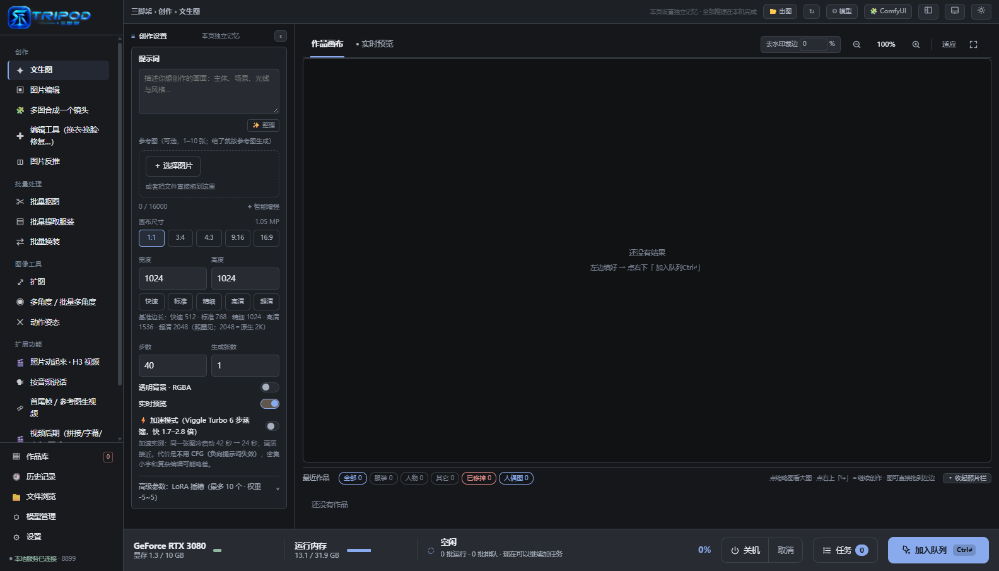
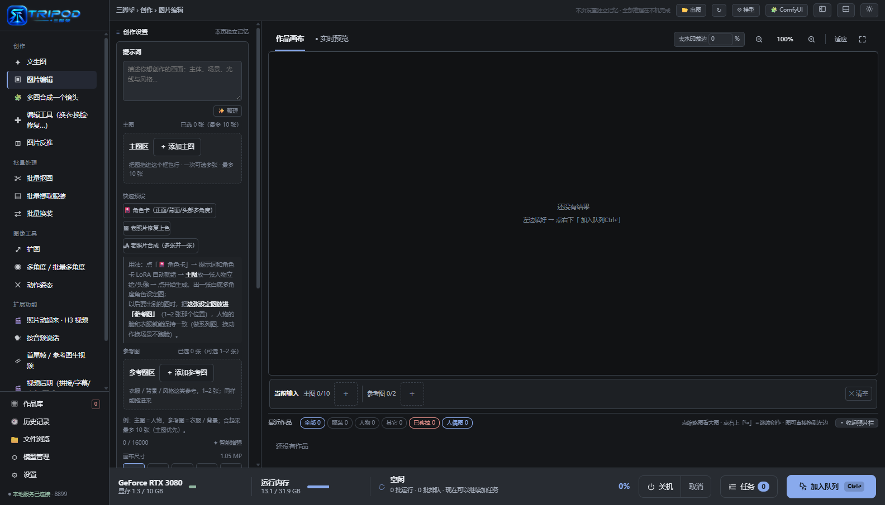
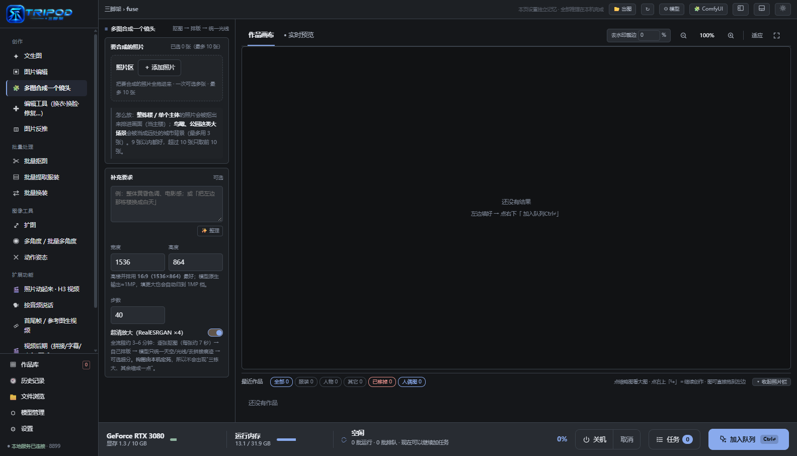
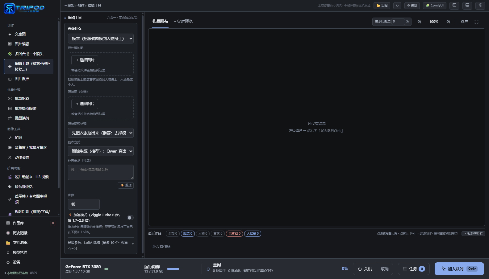
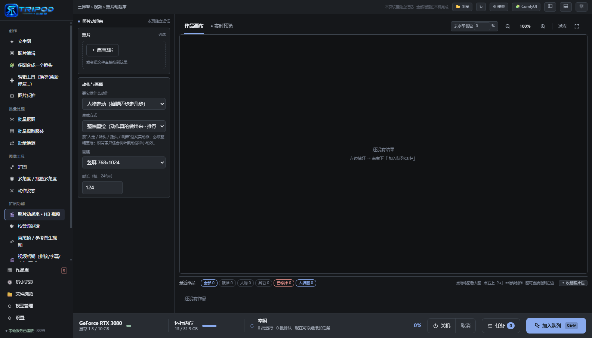

# 三脚架 · Tripod Panel

> **选图 → 用中文写一句话 → 点生成。** 把本机 ComfyUI 的顶级模型包成一个傻瓜式面板：
> 不用懂节点连线、不用搭工作流、不用管模型放哪；全文界面，出图/出视频/换衣/抠图/数字人一个界面走完。
> **推理全部在你自己机器上跑**，不上传、不调用任何云端 API。

> 🌐 **English:** [`README.en.md`](README.en.md) ｜ **模型清单:** [`models.md`](models.md) · [`models.en.md`](models.en.md)

> ⚠️ **本仓库只包含代码，不包含任何模型权重。** 模型请按 [`models.md`](models.md) 自己去官方源下载，
> 每个模型遵循它自己的许可证。使用前请读 [`DISCLAIMER.md`](DISCLAIMER.md)（免责声明）。

---

## 出发点：为什么会做这个东西

**先说结论：因为我自己被这些问题卡住过，而且它实在太难、太麻烦了 —— 所以干脆搭了一套框架，并且给它起名叫「三脚架」。**

**我碰到的问题：**

- ComfyUI 是目前最强的本地 AI 出图/出视频引擎，但它的门槛拦住了绝大多数人 ——
  要学**节点连线**、要搞懂**工作流**、要知道**模型放哪个目录**、要能看懂**一屏英文报错**、
  还要会处理**显存不够**；
- 会的人几分钟出图，**不会的人一晚上装不起来**；
- 商业网页版要钱，还**要把自己的照片传上去**；别的本地前端要么功能太少，要么照样得懂工作流；
- 更麻烦的是：想干的事情是**成套**的（出图 → 换装 → 抠图 → 做视频 → 配音 → 加字幕），
  每样都要换一个软件、重学一遍。

**所以我搭了这套框架，取名「三脚架」：**

- **ComfyUI 是地基和材料、模型是砖，这副架子负责的是"怎么搭"。** 常用的活都预先搭好了 ——
  文生图、图片编辑、换衣换发型换脸、老照片修复、抠图、扩图、多角度、动作姿态、照片动起来、
  按音频说话、首尾帧生视频、视频后期、配音、数字人，连提示词模板和参数档位都写在里面，
  **打开就能用，不用从零搭**；底下还有一层通用能力：作品库、历史记录、模型管理、任务队列、
  实时预览、内嵌原生 ComfyUI；
- **架子搭好了，剩下的是往上盖。** 想加一个页面、换一种模型、加一个功能，照着现成的那一套抄就行 ——
  后端一个 `panel.py`，前端一个 `new_ui.html`，没有框架、没有构建步骤。

**我希望的是：**

> **懂这个、要用这个的人，都自己往上加，把这栋房子造得更大更好，让需要的用户都能用上。**
> 具体怎么提，见文末的**「欢迎把你的想法加回来」**一节。

> 一句话：**把专业引擎包成傻瓜式平台，但推理仍然全在你自己的机器上跑。**

## 为什么叫「三脚架」

**工地上盖房子，第一步一定是先搭架子。** 架子立起来，砖才能一块块往上砌、一层层往上走；
房子盖完架子可以拆，但"能把它盖起来"这件事，是从那副架子开始的。**这个软件就是那副架子。**

- **ComfyUI 是地基和材料，模型是砖** —— 它们都在，可"怎么搭"没人告诉你：节点怎么连、参数给多少、
  模型放哪个目录、显存不够怎么办。这个面板把"怎么搭"固定下来：每个功能的工作流、提示词模板、
  参数档位、报错怎么说人话、临时文件怎么收干净，**全都已经写好了**。
- **它是给你——以及你的 AI Agent——用的脚手架。** 你不用从零搭：想加一个页面、换一种模型、
  加一个功能，**照着现成的那一套抄**就行（后端一个 `panel.py`，前端一个 `new_ui.html`，
  没有框架、没有构建步骤，改完刷新即生效）。
- **自己搭的会更齐全。** 只有你自己知道你要什么；这个框架负责的是"**不求人、不重来**"：
  每个功能都是一份可以照着改的样板 —— 工作流怎么连、参数怎么给、错误怎么讲成人话、
  中间产物怎么清干净。**架子已经立在这儿了，往上加就是了。**

名字还有第二层意思：**相机三脚架** —— 两条腿站不稳，三条腿才稳。这个软件追求的就是"稳"：
显存不够**自动降档**、ComfyUI 掉线**自动拉起**、新装了模型界面**自己重载**、
出错**说人话**而不是甩你一屏日志。

## 它解决了什么问题

| 普通人卡住的地方 | 这个平台怎么处理 |
| --- | --- |
| 节点、连线、工作流看不懂 | 全部预置成页面：文生图 / 图片编辑 / 换衣换脸 / 抠图 / 扩图 / 视频 / 配音 / 数字人…点开就用 |
| 不知道模型放哪、该下哪个 | 「模型管理」页告出**有什么 / 缺什么 / 放哪个目录**，`models.md` 给官方下载链接 |
| 显存不够就崩 | 自动降档（INT8 → Q4/Q8 GGUF）、一键释放显存、异常自动拉起 ComfyUI |
| 报错是一屏英文 traceback | 界面全中文，报错翻译成人话（例如"这一步本来就慢，不是坏了"）|
| 参数不知道调多少 | 自动选参考图编码精度、档位自动降级、姿势/风格/提示词都有预设 |
| 每次都要重新搭一遍 | 每页设置独立记忆、历史记录、一键「接着改」 |
| 不想把照片传到别人服务器 | **全部本机推理**：不联网调用云端 API，图片不出你这台机器 |

## 谁最适合用它（五类人 + 各自能干什么）

### ① 视频与艺术创作者

**一张照片、一段音频、几张素材，就能出短视频 / 口播 / 动态画面，而且"成片工序"全在一个界面里走完。**

- **照片动起来（MiniMax H3 图生视频）**：一张照片 → 一段视频，可描述动作/运镜，时长与分辨率可选；
- **首尾帧 / 参考图生视频**：给首帧＋尾帧自动补中间过程；或给参考图锁住人物与风格；
- **按音频说话**：让照片按一段音频开口说话（对口型）——音频可以是自己录的，也可以是面板生成的配音；
- **数字人**：一张照片 + 一段配音 → 口播视频（H3 引擎；LongCat 为可选引擎）；
- **配音**：文字描述音色（不需要参考音），或**克隆音色**（给 5–20 秒参考音），出 wav，直接喂给数字人/对口型；
- **视频后期**：多段拼接、**字幕文字叠加**（你写的一行/多行文字烧进画面；说明：不支持导入 `.srt` 文件）、水印、配乐、变速、**统一帧率**（复制/丢帧，不是插值补帧）、淡入淡出与段间黑场过渡，输出 MP4；
- **多图合成一个镜头**：几张素材自动抠图 → 自动排版 → 模型统一光线去接缝，出一张连贯画面（可以再拿去生视频）；
- 图像侧配套：文生图做封面与分镜、扩图、多角度、动作姿态（骨骼编辑器）、局部重绘、超清放大。

> 省事在哪：不用在"出图软件 → 剪辑软件 → 配音工具 → 字幕工具"之间来回倒腾，一条线在这个面板里走完。

### ② 小红书服装博主（服装 / 穿搭 / 电商）

**10 套衣服一次性导入，帮"一个人"自动换装——在你自己电脑上就能立刻看到每套搭配上身的效果。**

- **批量换装**：一个人 + N 套衣服 → 逐套自动穿上、一次出 N 张（人物与服装的配对方式可选）；
- **单张精细换装**：5 种模式（原样 / 整图保护 / 安全 / 模型姿态 / 整图），**脸、手、背景用原图像素贴回**，不会多手指多脚；
- **批量提取服装**：把穿搭图里的衣服抠成**白底商品图**，攒自己的素材库；
- **批量抠图**：出透明 PNG（做主图、贴纸、合成素材）；
- **换发型 / 换脸**：固定一个"模特形象"（换脸有高质 BFS 模式、强度可调）；
- **老照片修复上色**：翻新旧图素材；
- **图片反推**：读一张图 → 出可复用的提示词，保证整组图风格统一；
- **文生图 + 超清放大**：做封面/主图（RealESRGAN ×4 真超分）；
- **短视频**：换装结果直接做视频（照片动起来 → 视频后期加字幕配乐 → 配音）。

> 省事在哪：不用请模特、不用一张张 P 图；参数都是中文档位，显存不够会自动降档，不会把机器搞崩。

### ③ 电商卖家 / 外贸进出口 / 服装厂家 / 婚纱摄影 / 模特公司 / 广告公司（商家与工作室）

**这一类的共同点是：SKU 多、要的版本多、常常涉及客户或新品隐私 —— 而这三件事它都在本机解决。**

**国内电商卖家（淘宝 / 天猫 / 京东 / 拼多多 / 抖音小店）：产品图不用实拍**

> 不管你在哪个平台开店 —— **淘宝 / 天猫 / 京东 / 拼多多 / 抖音小店 / 亚马逊 / eBay / 独立站 / TikTok Shop** ——
> 主图、详情页、主图视频要的那些素材，都能在这儿自己出，不用每样都去实拍。

- **直接生成商品图**：文生图出白底图 / 场景图 / 氛围图，不用约棚、不用布景、不用修图师；
- **简单拍一张就够**：实拍一张平铺图 → **换背景 / 换场景**（木桌、厨房、户外、节日氛围），
  变成主图或详情页大图；
- **产品与人同框**：模特图 / 使用场景图（多图合成一个镜头、批量换装）；
- **多尺寸物料一次出**：扩图适配 1:1（主图）/ 3:4 详情 / 16:9 banner；
- **出印刷级大图**：RealESRGAN ×4 真超分（详情页长图、印刷稿）；
- **白底主图**：批量抠图 → 直接上架（**京东、亚马逊这类要求纯白底**的平台尤其省事）；
- **文案灵感**：图片反推出描述，写标题和详情页；
- **主图视频 / 详情视频**：照片动起来 → 视频后期（字幕 / 水印 / 配乐）→ 配音；
- **老图翻新**：旧商品图修复上色、重出高清版。

**外贸出口 / 跨境电商（亚马逊 / eBay / 独立站 / TikTok Shop）**

- **平台主图规格**：批量抠图出**纯白底**，再用 RealESRGAN 放大到平台要求的尺寸（≥2000px 那类）；
- **生活场景图不用真拍**：换背景 / 换场景 → 厨房、庭院、户外、节日；
- **A+ / 详情页 banner**：扩图适配各种长宽比，一次出多版；
- **多语言文案灵感**：图片反推可以让模型**用英文描述**，直接拿来写 listing 标题与五点描述；
- **主图视频**：照片动起来 → 视频后期（字幕 / 水印 / 配乐）→ 配音；
- **保密**：全部本机推理，**新款设计、客户素材不用上传到任何云端**（做外贸的尤其在意这点）。

**进口 / 内销 / 批发 / 仓库与供应链**

- **一个 SKU 一套素材**：白底图 + 场景图 + 多色多尺寸，全自动批量出；
- **供应商给的图太差**：老照片修复上色 + 超清放大，直接救活糊图、带水印的图；
- **大批量 SKU 一次处理**：批量抠图 / 批量提取服装 / 批量换装 / **批量多角度（最多 100 图 × 8 视角）**；
- **统一规格**：批量出白底、统一尺寸与格式，方便上架到不同平台；
- **上新预览**：不用动实物、不用拆包装，先生成图片看效果再决定推哪几款。

> ⚠️ **电商合规提醒（很重要）**：平台对"图文不符 / 虚假宣传"有明确规则。
> AI 生成的图**必须与实物一致** —— 用它做场景、氛围、构图、版式没问题，
> 但**不要用它伪造不存在的外观、功能或效果**。上线前自己核对一遍，责任在使用者。

**服装厂家 / 档口 / 电商供货**

- **上新出"模特上身图"**：一个模特 + N 套新款 → **批量换装**，不用每次约拍、约棚；
- **白底商品图**：批量提取服装 / 批量抠图，直接出电商主图素材；
- **版型与配色先看效果**：文生图 + 换装先预览，再决定打样与备货；
- **同款多色多场景**：换背景/换场景批量出图（人物原样贴回，脸不会变）；
- **旧样册数字化**：老照片修复上色。

**婚纱摄影店 / 影楼**

- **客片不用重拍**：换背景 / 换场景（海边、教堂、森林、纯色棚），**人物与妆发用原图像素贴回**；
- **婚纱试穿预览**：一套婚纱 + 多个场景，先给客人看效果再约档期；
- **一图多版**：同一张原片出多种风格版本，便于选片、加片；
- **相册与 demo 视频**：照片动起来 → 视频后期（拼接/字幕/配乐）→ 配音；
- **增值服务**：给客人翻新父母的老照片（修复 + 上色）。

**模特公司 / 经纪**

- **模卡（comp card）**：一张正脸 → 多角度设定图（角色卡预设），出统一风格的模卡；
- **不同 look 的 portfolio**：换衣 / 换发型 / 换背景，快速攒作品集；
- **试镜视频**：照片动起来、按音频说话（自我介绍口播）；
- **新人建档**：批量抠图出统一底色素材。

**广告公司 / 设计工作室 / 自媒体团队**

- **提案与比稿**：文生图 + 多角度 + 扩图，快速出多版视觉；
- **分镜与动态预览**：照片动起来、首尾帧生视频，做 animatic；
- **成片工序**：视频后期（拼接 / 字幕 / 水印 / 配乐）；
- **多尺寸物料**：扩图适配 1:1 / 9:16 / 16:9，超清放大出印刷级素材；
- **配音试听**：多种音色（文字设计音色 / 克隆音色）出广播稿 demo。

> **为什么这一类特别适合**：① **省成本** —— 不用每次约模特、约棚、约修图师；
> ② **能批量** —— 一次几十张，不是一张张 P；③ **保密** —— 全部本机推理，
> **客户素材不出你这台电脑**（这是很多工作室不能碰云端 API 的原因）。
>
> ⚠️ **商用请自己把关**：模型各自的许可证（有的禁止商用）、以及肖像/声音的**当事人授权**，
> 都要先确认；详见 [`DISCLAIMER.md`](DISCLAIMER.md)。

### ④ AI 爱好者与学习者

**这是一套"已经写好的教材"：最新本地模型的完整流程、参数、提示词模板都摆在明面上，装上就能玩、能对照着学。**

**可以拿来学什么（流程都已在软件里写好，不用自己从零搭）：**

- **学 ComfyUI**：每个功能对应的**工作流已经内置**，还能在面板里**直接打开原生 ComfyUI 界面**（8188）对着看
  —— 节点怎么连、参数怎么给、模型怎么加载，边跑边对照，比啃文档快得多；
- **学 Qwen-Image（千问图像）**：文生图、图片编辑、多图参考这几条路的**完整流程与参数**（编码精度、分辨率档、CFG、步数、
  负向词、LoRA 强度）都写在面板里，可以一项项对照着试，理解"参数怎么影响结果"；
- **学 MiniMax H3（视频）**：图生视频、首尾帧、参考图生视频、按音频说话、数字人——同一个 H3 体系，
  还能看到 Q4 / INT8 档位在 10GB 显存上的真实差别；
- **学 TTS**：Breeze-TTS 的**音色设计**与**音色克隆**（含"参考音必须给原话"这类真实约束）；
- **学提示词工程**：图片反推（读图出描述）、智能增强、提示词工具、各功能的模板与负向词，都能直接看、直接改；
- **读源码学后处理**：换衣的遮罩保护、扩图的泊松融合与接缝重绘、多图合成的抠图+排版，这些**不是黑盒**——
  后端就一个 `panel.py`，想看哪段看哪段。

**动手层面：**

- **参数全都露给你**：模型档位（INT8 / Q4 / Q8 / FP8 GGUF）、**LoRA 插槽最多 10 个、权重 -5~5**、
  采样步数、CFG、**参考图编码精度 512~2048**、随机种子、参考图张数；
- **模型管理**：清单、**文件头校验**（能看出下了一半/坏了）、一键释放显存、模型目录指纹（新装模型界面自动重载）；
- **历史记录**：每次任务的提示词、参数、耗时、产物都留着，可复制、可"接着改"，方便对比复盘；
- **可改造**：后端单文件 + 前端单文件、无构建步骤；100% 本机推理、可离线，代码随你改。

> 为什么适合学习：不必先成为 ComfyUI 高手，也能看清"这些模型各自能做什么、参数怎么影响结果"。

### ⑤ 零基础小白（这才是它存在的理由）

**会打字就能用；连安装都可以交给 AI 助手替你装。**

- **一句话出图**：文生图 → 写一句中文 → 点生成；尺寸/步数/档位都有默认值，显存不够自动降；
- **三个一键预设**：角色卡（正/背/头多角度设定图）、老照片修复上色、老照片合成；
- **短视频全自动**：照片动起来 → 视频后期（拼接/字幕/水印/配乐）→ 配音，点几下就成片；
- **多图合成一个镜头**：几张照片丢进去，自动抠图、自动排版、统一光线，出一张像样的画面；
- **中文界面 + 人话报错**：不是一屏英文；出错会告诉你"哪里不对、怎么办"；
- **双击即用**：Windows 双击启动脚本就有窗口，不用碰命令行；也可以只用浏览器打开；
- **装不上也不怕**：下面有一整段"把这段话复制给你的 AI 助手"，让它替你找路径、装依赖、下模型、排错。

> 为什么敢给小白：默认全自动，误操作代价低——每次任务都有历史记录，随时回看、重跑。


## 傻瓜式体现在哪

- **一个界面走完全部**：不用懂节点、不用懂工作流、不用懂 LoRA；
- **全中文 + 人话报错**：出错告诉你"哪儿不对、怎么办"，不是丢一堆日志；
- **全自动**：档位自动选、显存不够自动降、ComfyUI 掉线自动拉起、模型新装了界面自动重载；
- **一键启动**：Windows 上双击 `启动三脚架.vbs` 就是一个原生窗口，没有命令行黑窗；
- **装不上也不怕**：下面有一整段"把这段话复制给你的 AI 助手"的安装方式，
  让 Agent 替你做"找路径、装依赖、下模型、填配置、排错"这些最烦的事。

---

## 界面预览

> 下面截图取自**全新的空实例**（作品栏为空），不含任何使用者的图片。

| 文生图 | 图片编辑 |
| --- | --- |
|  |  |

| 多图合成一个镜头 | 编辑工具 |
| --- | --- |
|  |  |

| 照片动起来（视频） | |
| --- | --- |
|  | |

---

## 它是什么

ComfyUI 功能强大但门槛高：要记节点、连线、模型放哪个目录。这个面板把它收进一个界面里：
**选图 → 写一句话 → 点生成**，剩下的交给它。所有推理都在本机，断网也能用。

主要功能（都在同一个界面里，下面是**全部功能清单**）：

**创作**

| 功能 | 具体能干什么 |
| --- | --- |
| 文生图 | 中文提示词出图；参考图 1–10 张（多图参考）；画布 1:1 / 3:4 / 4:3 / 9:16 / 16:9；基准边长 512/768/1024/1536/2048；步数、张数、随机种子；透明背景 RGBA；实时预览；加速模式 |
| 图片编辑 | 主图最多 10 张 + 参考图；参考图编码精度可调（防压死机器）；说"换背景/换场景"会自动切成"只重画背景、人物原样贴回" |
| 换衣 | 5 种模式（原样 / 整图保护 / 安全 / 模型姿态 / 整图）；脸、手、背景用原图像素贴回 |
| 换发型 | 只换发型，保留脸与背景 |
| 换脸 | 高质 BFS 模式（走提示词 + BFS 头部 LoRA）、强度可调；另有 insightface + inswapper 的快速换脸 |
| 老照片修复上色 | 一键修复 + 上色（内置专用正向/负向词） |
| 移除对象 | 涂掉画面里不想要的东西 |
| 局部重绘 | 涂抹区域按提示词重画 |
| 图片反推 | 本机 Qwen3-VL 读图 → 出可直接用的提示词；可改写、可换语言 |
| 一键预设 | 🎴 角色卡（正/背/头多角度设定图）、🖼 老照片修复上色、🏞 老照片合成 |

**多图合成**

| 功能 | 具体能干什么 |
| --- | --- |
| 多图合成一个镜头 | 2–10 张照片 → 逐张抠图分类 → **自己排版**（天空 / 远景雾带 / 主体站齐 / 水面倒影）→ 模型只统一光线、去掉拼接痕迹 → 可选 RealESRGAN 超分 |

**批量处理**

| 功能 | 具体能干什么 |
| --- | --- |
| 批量抠图 | 一次多张 → 透明 PNG |
| 批量提取服装 | 穿搭图 → 白底商品图 |
| 批量换装 | 一个人 × N 套衣服，逐套出图 |
| 批量多角度 | 最多 100 张图 × 8 个视角 |

**图像工具**

| 功能 | 具体能干什么 |
| --- | --- |
| 扩图 | 四边外扩；泊松融合接缝 + 接缝带二次重绘；原图像素不改 |
| 多角度 | 水平 / 俯仰 / 远近 8 个视角，生成同一主体的新视角 |
| 动作姿态 | 三维骨骼编辑器摆姿势 → 出姿态图 / 人偶图；姿势可存进姿势库 |

**视频**

| 功能 | 具体能干什么 |
| --- | --- |
| 照片动起来（H3 图生视频）| 一张照片 → 视频；动作/运镜描述；时长与分辨率可选；档位可选 Q4（省显存）/ INT8（更好看但慢） |
| 按音频说话 | 照片按音频开口说话 |
| 首尾帧 / 参考图生视频 | 首帧 + 尾帧自动补中间；或给参考图锁人物与风格 |
| 视频后期 | 多段拼接、**字幕文字叠加**（把你写的一行/多行文字烧进画面 —— 说明：不支持导入 `.srt` 字幕文件）、水印、配乐、变速、**统一帧率**（复制/丢弃帧来改帧率，不是插值补帧）、淡入淡出与段间黑场过渡；输出 MP4 |

**音频 / 数字人**

| 功能 | 具体能干什么 |
| --- | --- |
| 配音（Breeze-TTS）| 文字描述音色（无需参考音）或克隆音色（5–20 秒参考音 + 原话必填）；出 wav，可直接给数字人用 |
| 数字人 | 照片 + 配音 → 口播视频（默认 H3 引擎；LongCat 可选） |

**系统 / 通用**

| 功能 | 具体能干什么 |
| --- | --- |
| 作品库 | 出图目录里的全部作品，分类筛选（全部 / 服装 / 人物 / 其它 / 已移掉 / 人偶图）|
| 历史记录 | 每次任务的提示词、参数、耗时、产物；可复制提示词、可"接着改" |
| 文件浏览 | 浏览本机出图 / 输入目录 |
| 模型管理 | 模型清单、文件头校验（能看出半个文件/坏文件）、一键释放显存；新装模型界面自动重载 |
| 任务队列 | 排队 / 取消 / 重试 / 停止本批；实时进度与耗时 |
| 实时预览 | 采样过程中的画面预览 |
| 内嵌原生 ComfyUI | 面板里直接打开 8188 的原始界面；可"回三脚架"、可"重载" |
| 设置 | 路径、访问模式（仅本机 / 局域网）、输出目录、ComfyUI 直连开关 |
| 桌面窗口 | Electron 原生窗口（无浏览器、无控制台黑窗）；也可以纯浏览器使用 |
| 自动与自愈 | 档位自动降级、显存不足自动处理、ComfyUI 掉线自动拉起、界面更新自动重载 |

界面是**单文件 HTML**（`new_ui.html`），后端是**单文件 Python**（`panel.py`），外壳是一个极小的
Electron 窗口（`shell/`）——没有前端框架、没有构建步骤，改完刷新即可。

---

## 环境要求

- **Windows 10/11**（面板本身是跨平台的，但启动脚本目前只写了 Windows）
- **一块 NVIDIA 显卡**：8GB 显存能跑通小图；12GB 以上体验会好很多（视频/数字人很吃显存）
- **Python 3.10+**（用 ComfyUI 自带的 venv 最省事）
- **[ComfyUI](https://github.com/comfyanonymous/ComfyUI)** 本体，且能正常出图
- **ffmpeg**（只有视频后期/转码需要；装了并加入 PATH 就行）
- 可选：Node.js 18+（想用那个原生窗口外壳时才需要）

---

## 快速开始

```text
1) 先确保 ComfyUI 本身能跑起来（记下它的目录，里面有 main.py）

2) 下载模型：按 models.md 把还缺的权重放进对应目录（这是最花时间的一步）

3) 配置路径：
   复制 panel_config.example.json → panel_config.json
   把 comfy_dir / comfy_python / model_roots 填成你这台机器的真实路径

4) 装依赖（装进 ComfyUI 自己的 venv，注意是 ComfyUI 目录里的 .venv）：
   <ComfyUI>/.venv/Scripts/pip install -r requirements.txt
   （如果这个 venv 不存在，就在 ComfyUI 目录里先跑一次 python -m venv .venv 再装）

5) 启动：
   · 想用原生窗口：先 cd shell && npm install，再双击 启动三脚架.vbs
   · 只想用浏览器：双击 _launch_panel.ps1，或者用**第 4 步那个 venv 里的 python** 跑：
        <ComfyUI>/.venv/Scripts/python.exe panel.py
     ⚠ 不要用系统 python 直接跑 —— 依赖装在 venv 里，系统 python 会报
       ModuleNotFoundError: No module named 'cv2'。
     起来后打开 http://127.0.0.1:8899/new
```

### 配置项（panel_config.json）

| 键 | 含义 | 留空时的默认 |
| --- | --- | --- |
| `comfy_dir` | ComfyUI 源码目录（含 `main.py`）| 自动探测常见位置，找不到会提示 |
| `comfy_python` | 跑 ComfyUI 的解释器 | 会依次找 `<comfy_dir>/.venv`、`<comfy_dir>/../.venv`、`pythonw.exe`（Windows 上优先 `pythonw.exe`，不会弹黑窗）|
| `user_dir` / `input_dir` / `output_dir` | ComfyUI 的数据目录 | 各自的 `<comfy_dir>/user|input|output` |
| `model_roots` | 模型根目录（可多个）| `[<comfy_dir>/models]` |
| `lora_dir` | LoRA 目录 | 第一个含 `loras` 的模型根 |
| `insightface_dir` | 换脸模型目录 | `<模型根>/insightface` |
| `ffmpeg` / `ffprobe` | 转码工具路径 | 去 `PATH` 里找 |
| `save_dir` | 「另存一份」目录 | 留空＝不另存；填了必须是**已存在**的普通目录（出于安全，不能指向系统目录/用户配置区）|
| `node_fp8_loader`、`node_outpaint_canvas`、`node_outpaint_composite`、`node_prompt_enhance` | 可选：第三方 ComfyUI 节点类名 | 留空时相关功能会给出中文提示，告诉你该填哪个键 |
| `access_mode` | `local` 只本机 / `lan` 局域网 | `local` |
| `lan_token` | 局域网模式的访问令牌（自动生成）| 开启 lan 后自动生成；局域网里要用带 `?token=` 的地址打开（启动日志里会打印）。**桌面外壳与本机浏览器不受影响** |
| `comfy_port` | ComfyUI 端口 | `8188` |

也可以不用配置文件，直接用环境变量：`PANEL_COMFY_DIR`、`PANEL_COMFY_PYTHON`、`PANEL_INPUT_DIR` …（键名大写加前缀）。

---

## 🤖 借助 AI Agent 协助安装（推荐）

装这套东西最烦的是"路径对不上、模型放错目录、依赖没装"。**把下面这段整段复制给任意 AI Agent**
（Claude Code / Codex / Cursor / 通义灵码…都行，只要能跑命令行），它会替你做完并排错：

```text
我在 Windows 上要装一个叫「三脚架（Tripod Panel）」的本机 AI 生图面板，它是 ComfyUI 的图形封装。
仓库我已经下载/克隆到本地了，请帮我装起来，按下面步骤做，每一步都先告诉我在干什么：

1) 找到我机器上的 ComfyUI 安装目录（含 main.py 的那个）和它的 venv 解释器
   （Windows 优先 pythonw.exe，因为 python.exe 会弹终端黑窗）；
2) 在 ComfyUI 的 venv 里安装依赖：numpy、opencv-python（requirements.txt）；
   如果要换脸功能，再装 insightface + onnxruntime；
3) 读仓库里的 models.md，逐个检查模型是否已存在；缺的**先列一张清单**（模型名/大小/下载链接/
   放到哪个目录）给我确认，再下载；不要一次下几百 GB；
4) 复制 panel_config.example.json 为 panel_config.json，把 comfy_dir、comfy_python、user_dir、
   input_dir、output_dir、model_roots、lora_dir、insightface_dir、ffmpeg 都填成我这台机器的
   真实路径（注意 JSON 里 Windows 路径要写成双反斜杠）；
5) 起面板验证：运行 python panel.py，然后访问 http://127.0.0.1:8899/new 应返回 200；
   若失败就读控制台输出 / comfyui_panel.log 排错（常见原因：路径填错、8899 端口被占、
   ComfyUI 没起来、模型目录没配对）；
6) 最后告诉我：哪些功能现在可用、哪些还缺模型。

注意事项（重要）：
- 不要改动我的系统代理 / 网络设置；
- 不要按进程名结束我的浏览器（chrome/msedge）或任何不是我让你起的进程；
- 下载大文件前先跟我确认；不要把我的私人图片、配置或路径写进任何要提交的文件里。
```

装完之后，日常只需要双击启动脚本。面板改的是 `new_ui.html` / `panel.py`，改完刷新页面即生效。

---

## 常见问题

**Q：启动后提示"找不到 ComfyUI"？**
`panel_config.json` 里的 `comfy_dir` 没填对。那个目录里必须能看到 `main.py`。

**Q：任务一直排队 / 显示 ComfyUI 没在跑？**
面板会尝试自动拉起 ComfyUI。手动确认：浏览器打开 `http://127.0.0.1:8188` 有界面就说明在跑。

**Q：屏幕上偶尔闪一个黑色终端窗口？**
说明 ComfyUI 是用 `python.exe` 起的。把 `comfy_python` 改成同目录的 `pythonw.exe` 即可。

**Q：提示端口被占用（8899）？**
把占用它的面板进程关掉，或用环境变量 `PANEL_PORT=8900` 换一个端口起。

**Q：模型管理页里一堆"缺失"？**
正常——按 `models.md` 补；面板只报告缺什么，不会偷偷下载。

**Q：显存不够怎么办？**
界面上把「模型档位」从 INT8 换成 Q4/Q8 GGUF（省一半以上显存，代价是速度/质量略降）。

---

## 目录结构

```
panel.py                 后端：本机 HTTP 服务 + ComfyUI 客户端 + 各功能的提示词/后处理
new_ui.html              界面：单文件（HTML+CSS+JS），无构建步骤
clothing_mask.py         换衣用的遮罩模块（脸/手/背景原样贴回）
panel_config.example.json 配置示例（复制成 panel_config.json 用）
shell/main.js            Electron 外壳（把面板包成原生窗口）
shell/package.json       外壳依赖（electron）
启动三脚架.vbs / _launch_panel.ps1   Windows 启动脚本
tools/upscale_esrgan.py  超分放大 CLI（面板里也有对应按钮；用法见文件头注释）
logo_*.png / brand_lockup.png  图标
```

---

## 欢迎把你的想法加回来（这才是"架子"该有的样子）

这个软件从第一天起就是**脚手架**：它把"怎么搭"写好了，但**没有规定只能搭成什么样**。
你在用的时候一定会碰到"要是有这个功能就好了"的时刻 —— 那就把它加回来。

**欢迎提交的东西（举几个例子）：**

- **你搭好的流程/框架**：比如一套"10 套衣服批量换装 → 出图 → 配文案 → 做视频"的完整工作流，
  或者一种新的合成排版方式；
- **更好的提示词模板 / 参数默认值**：某个功能在你的机器上、你的题材上效果更好，就把那套参数提上来；
- **新模型、新档位支持**：新出的模型、更省显存的量化档、新的加载器；
- **把"神秘失败"变成一句人话**：你踩过的坑 + 报错原因 + 一句中文提示，这类贡献价值极高；
- **新页面 / 新功能**：照着现成的页面抄一遍就行（每个功能都是一份样板）；
- **文档、翻译、截图、更好的默认值** —— 都算。

**怎么提（很短）：**

```text
1. Fork 这个仓库，改 panel.py 和/或 new_ui.html（就这两个文件，不用动别的）
2. 起一个独立实例自测：PANEL_PORT=8911 python panel.py → 打开 http://127.0.0.1:8911/new
   （README 里那段"交给 AI Agent"的提示词，可以直接让你的 Agent 帮你验）
3. 提 PR，说明三件事：改了什么 / 为什么改 / 你怎么验证的
```

**几条约定（让合并变简单）：**

1. **不引入框架和构建步骤** —— 后端保持一个 `panel.py`、前端保持一个 `new_ui.html`，改完刷新就是新版；
2. **报错必须说人话**（中文），能说"哪儿不对、怎么办"就别甩一屏 traceback；
3. **涉及显存/GPU 的改动请注明测过的显存**（例如"10GB 卡 + INT8 实测通过"）；
4. **不要提交模型权重**（本仓库不带权重，只给下载链接）；
5. **不要提交私人图片、私人路径、任何密钥**（`.gitignore` 已经挡了一层，提 PR 前自己再看一眼）；
6. 优先 Windows，但跨平台更好；
7. 一个 PR 只做一件事，方便回滚。

**不写代码也能贡献：** 提 Issue 说清你想要什么流程、贴一张效果图、写一段你常用的提示词/参数组合，
或者把别人踩过的坑记下来 —— 这些都会被并进文档和默认值里。

> 一句话：**这里的默认值不是标准答案。** 你搭得更好，就换掉它、加回来，让下一个人省点事。

---

## 许可证与免责

- **代码**：MIT，见 [`LICENSE`](LICENSE)。
- **模型**：本仓库**不包含**任何模型权重，全部由你自行从官方渠道获取，各自遵循各自许可证
  （其中有些禁止商用，请自行确认）。
- **免责声明**：见 [`DISCLAIMER.md`](DISCLAIMER.md)。**使用本软件产生的任何内容与后果，由使用者自负。**
